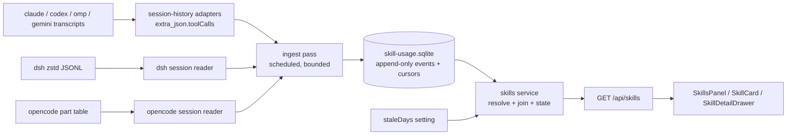

# Skill Usage Tracking

*   **Author:** adversity
*   **Status:** Draft
*   **Date:** 2026-11-27

--------------------------------------------------------------------------------

## Overview

The Skills surface of this tool lists one row per deduped installed skill, per
platform, but it cannot say which skills are used. This design adds a use count
(measured in user turns), a last-used time, and a "not used in N days" tag to
each row, computed from local CLI session transcripts.

The data is not in the index in usable form: message content is persisted only
for `role='user'` rows, `extra_json` exists on every message row but is written
as `null`, and the adapters discard the tool payloads they already parse. The
design therefore adds a durable, append-only usage ledger fed by per-platform
extractors, and joins it into the existing list payload at read time.

Scope is one machine's local CLI sessions, across all projects, including
model-triggered and user-triggered use. Counts cover surviving transcripts only;
a session deleted before the first fold is invisible. Counts never decrease when
transcripts expire or a cache is cleared.

A **use** means one user turn in which the skill was read. One skill read three
times in the same turn counts once; the same skill used in two turns counts
twice.

## The Problem

Users accumulate skills faster than they can audit them. A skill that is never
invoked still costs attention in every skill list and, on Codex, tokens in the
injected catalog. Today there is no evidence to act on: no counter, no last-used
time, no record of which skill a tool call loaded.

Three measurements define the problem and rule out the obvious shortcuts:

1. The session index stores 333,509 messages for 2,039 sessions. Message content
   is persisted only for user rows; every assistant and tool row is empty. The
   index records that a tool ran, never which skill it touched.
2. Text matching measures the catalog, not use. The Codex corpus contains 576,277
   occurrences of `SKILL.md`, almost all from the injected catalog, while tool
   calls that read a skill file number 180.
3. Skill use is recorded in different fields per platform: a `Skill` tool call on
   Claude (11 observed), `read skill://<name>` on omp (458 observed), `parsed_cmd`
   read entries on Codex (180 observed), explicit file reads on dsh (266
   observed). No single rule covers them.

The consequence of guessing wrong is asymmetric. A missed use may prompt a
manual deletion of a skill that is still needed; an over-counted use only
overstates a number. The design therefore prefers an explicit pending or
unsupported state over a wrong claim, and makes the evidence base visible in the
UI.

## Goals

*   Show, per installed skill and per platform, a use count in user turns and a
    last-used time derived from local CLI transcripts, across all projects.
*   Cover all six platforms (claude, codex, gemini, opencode, omp, dsh) in the
    first release, with the extractor contract in D3.
*   Mark a skill `近 N 天未使用` only when no use was observed within N days, the
    observed coverage spans N days, the installed artifact is ready, and the
    platform's extractor has been calibrated by at least one observed skill
    event.
*   Backfill all existing local history once, then update incrementally; running
    a scan twice produces the same counts.
*   Keep counts monotonic: deleting transcripts, expiring sessions, rebuilding
    the index, or clearing the cache does not change any displayed count. The
    only reset is deleting the ledger file.
*   Expose one server-side global setting for N days, default 30, validated on
    write and applied to every platform.
*   Make the evidence base legible: the detail drawer states the observed
    coverage window, and a platform that parses nothing, or has never observed a
    skill event, says so instead of showing zero as a fact.

## Non-Goals

*   IDE-hosted sessions and sessions from other machines. They are not in the
    transcript roots this tool can read.
*   Subagent transcripts (`agent-*.jsonl` under `~/.claude/projects`). They are
    excluded so the usage number describes the same session set the rest of the
    product shows; a skill used only by a subagent reads 0.
*   Automatic deletion or disabling of skills. This feature adds no path that
    deletes, disables, or edits a skill.
*   Per-platform thresholds or per-skill thresholds. One global value.
*   Usage-based sorting, ranking, trend charts, or per-day buckets.
*   Counting skills bundled in plugin caches that are not in the managed
    catalog; unresolved reads appear only in the diagnostic counter.
*   Counting catalog text, prompt injections, `AGENTS.md`/`CLAUDE.md` content, or
    search and glob patterns as use.

--------------------------------------------------------------------------------

## Technical Plan (Architecture)

### Shape

Five parts, all reusing existing machinery:

1. **Extractors.** The four session-history adapters (claude, codex, omp, gemini)
   emit a compact `toolCalls` array into the `extra_json` column that already
   exists on every message row. The dsh and opencode readers return tool records
   to the ingest pass; they do not write to the ledger.
2. **Ledger.** A separate SQLite database under the durable storage root, with
   append-only event rows and no foreign keys to index tables.
3. **Ingest.** A scheduled, bounded pass. For the four adapter platforms it calls
   `ensureSourceIndexed(source)`, which inventories and parses transcripts when
   the index is stale, then reads only rows that carry `toolCalls`. For dsh and
   opencode it asks their readers for records. It inserts events with
   `INSERT OR IGNORE`, records a per-session cursor, and holds its own pid lock.
4. **Read path.** The skills service resolves each event to an installed row,
   joins after the existing dedupe pass, computes the state, and returns it with
   the list.
5. **Settings and UI.** One global `staleDays` value and three additive pieces of
   UI on existing components.



### Turn semantics and event identity

The counting unit is one user turn per skill. A turn starts at a user message and
ends at the next user message in the same session. One skill used three times in
one turn counts once; the same skill used in two turns counts twice.

Event identity is the tool call, not the turn:

```text
event_key = sha256(platform | session_id | call_id | normalized_name | raw_target_kind)
count     = COUNT(DISTINCT COALESCE(turn_key, call_id))
```

`call_id` is the provider's tool-call id (`tool_use.id`, codex `call_id`, omp
`toolCall.id`, dsh `data.callId`, gemini tool-call id, opencode part id). When it
is absent, the fallback is `sha256(file_path | line_offset | ordinal)`. The
fallback is deterministic, so a re-scan produces the same key.

`turn_key` is a derived attribute, not part of identity. Changing the anchor rule
therefore changes the read-time grouping only; it never inserts a second row for
the same call. A second read of the same skill in one turn produces a second
event row with the same `turn_key`, and the read path counts it once.

Turn anchor per platform. One helper in the ingest pass owns this; extractors
emit raw calls only.

| Platform | Turn anchor |
| --- | --- |
| claude | id of the most recent user message (the adapter's user row; tool results are not user turns) |
| omp | id of the most recent user message record |
| codex | `payload.turn_id` when present; otherwise the most recent user message id (617 of 1,547 local rollouts lack `turn_id`) |
| gemini | id of the most recent message with `type='user'` |
| opencode | id of the most recent user message in the session |
| dsh | `data.turn` combined with the session id |

If a session contains a tool call before its first user message (truncation,
resumed fork), every such call anchors to `<session_id>#0` and the group counts
once. A forked session that copies a transcript under a new session id is a new
identity; the fork limitation is listed in Risks.

### Data model

`skill-usage.sqlite` (new, durable, opened through the existing SQLite helper):

- `usage_event`
  - `event_key TEXT PRIMARY KEY` — hash of `platform | session_id | call_id |
    normalized_name | raw_target_kind`
  - `platform`, `session_id`, `turn_key`, `call_id`, `extractor_version`
  - `raw_name`, `normalized_name`, `base_name`, `raw_target`, `skill_root`,
    `session_cwd`
  - `occurred_at INTEGER` (epoch ms), `inserted_at INTEGER` (epoch ms)
  - append-only; `INSERT OR IGNORE`; no foreign keys.
- `usage_event_skill` — `CREATE INDEX ON usage_event(platform, normalized_name,
  occurred_at)`; the read path's only query uses it.
- `skill_observation`
  - `platform`, `normalized_name`, `first_seen_at`
  - write-once, `PRIMARY KEY (platform, normalized_name)`.
  - Reason: when `birthtime` is unavailable or zero, this is the only valid
    lower bound for eligibility.
- `usage_scan_state`
  - `platform` primary key, `coverage_start`, `coverage_end`, `status`,
    `parse_failures`, `non_skill_calls`, `unresolved_skill_reads`,
    `skill_events`, `calibration_positive_at`, `updated_at`.
- `usage_cursor`
  - `platform`, `session_id`, `size`, `mtime_ms`, `parser_version`,
    `status` (`'pending'` or `'done'`), `updated_at`;
    `PRIMARY KEY (platform, session_id)`.

No aggregate table: `COUNT(DISTINCT COALESCE(turn_key, call_id))` and
`MIN/MAX(occurred_at)` over the indexed rows is cheaper than a second write path.
At the measured rate (about 2.5k events over months) the table stays small.

Normalization: lowercase; strip a `skill://` prefix and any `/<subpath>` suffix;
keep any `<namespace>:` prefix in `normalized_name`. `base_name` is the part
after the last `:`. Namespace stripping is not allowed: it would merge a plugin
skill into a managed skill with the same base name.

### Extraction per platform

| Platform | Signal | Notes |
| --- | --- | --- |
| claude | `tool_use` block with `name='Skill'` and `input.skill` | Namespaced plugin names are kept. Subagent `agent-*.jsonl` excluded |
| codex | `event_msg` / `exec_command_end` with `parsed_cmd` entries `{type:'read', path:'<root>/<name>/…'}` | Requires a `codex/parser.js` change; `rg`/`grep`/`find`/`glob` never count |
| omp | `toolCall` with `name='read'` and `path` starting `skill://` | Subpaths map to the first segment; `arguments` is a JSON string |
| dsh | `tool/call` with `name='read'` and a path under a skill root, or `name='bash'` with an explicit `cat/head/tail/sed` of such a path | `data.callId`, `data.arguments` is a JSON string; roots come from `resolveSkillRoots` (user, project `<cwd>/.dsh/skills`, custom) |
| gemini | `toolCalls[]` with `name ∈ {read_file, run_shell_command}` reading a skill path | No live positive on this machine; extractor is fixture-tested and the platform starts `unverified` |
| opencode | `part.data.type='tool'` reading a skill path | No live positive; fixture-tested, starts `unverified` |

Skill roots are the platform's existing discovery roots plus project-local
directories, resolved by the same helper the platform already uses. A read that
resolves to no installed skill increments `unresolved_skill_reads` and is stored
with `skill_root = null`; it never attaches to a row.

### Ingest and scheduling

The ingest pass is a recurring job started from `src/server/index.js`, first run
60 s after boot, then every 60 s while any platform is incomplete and every
10 minutes once all platforms are complete. It holds its own pid lock
`<ledger>.usage.lock`, and stops on server shutdown.

Per tick:

1. For each of the four adapter platforms, call
   `ensureSourceIndexed(source)`. This is the parse trigger: it inventories and
   parses when the source is stale or a parser migration is pending, and returns
   immediately when the index is fresh. It is never called from an HTTP request.
2. Ask `listToolCallMessages(source, sessionId)` — a new export of
   `session-history-index.js` — for rows that carry `toolCalls`. Each row also
   carries the enclosing user-turn number, resolved by a correlated subquery over
   `session_message.role = 'user'`, so a tool-call row has a turn anchor without
   reading user content.
3. For each session whose `(size, mtime_ms, parser_version)` differs from
   `usage_cursor`, fold its calls: resolve the anchor, compute `event_key`,
   insert with `INSERT OR IGNORE`, then upsert the cursor in the same
   transaction. If the insert produced at least one new skill event,
   `calibration_positive_at` is set once per platform. `status` becomes `done`
   for that session.
4. For dsh and opencode, call their readers' new `listToolCalls()` functions and
   fold the same way, keyed by the session id the reader reports.
5. After all platforms, recompute per-platform coverage: `coverage_start` is the
   earliest session timestamp and `coverage_end` the latest, over sessions whose
   cursor status is `done`. A platform's pass is `complete` when every indexed
   session has a matching cursor and no session is left in `pending`.

Budgets per tick: `maxSessions = 200` and `maxMs = 15000`. A tick that hits
either budget stops and resumes from its cursor on the next run.
`usage_scan_state` is updated at the end of each platform's turn, never per row.

Cost: the index already parses these sessions; the fold reads one JSON column and
hashes a key. The one-time cost is the `parser_version` bump (2 → 3) that forces
re-parsing of 2,039 sessions once. The measured parse time is 4–8 seconds for the
omp corpus; the Codex corpus (1,547 sessions) is unmeasured, so the first pass may
span several ticks.

Deletes: `_pruneMissingFiles` removes index rows; the ledger is untouched, so
counts do not fall. Re-parsing a session with the same `call_id` produces the same
`event_key`, so it is a no-op. Re-parsing a session with a new session id (fork)
produces new keys; this is a known limitation, listed in Risks.

### Read path and state computation

Each event is resolved to at most one visible row, in this order:

1. A row whose projected directory is a prefix of `skill_root` for the same
   platform.
2. A unique installed row on the event's platform whose `normalized_name` or
   `base_name` matches.
3. A unique installed row across all platforms whose name matches; the event is
   then owned by that row's platform, not by the session's platform.
4. Otherwise the event is unattributed: `unresolved_skill_reads`, no row.

A project-scoped row wins over a user-scoped row when `session_cwd` falls under
the project path and the names match. Two rows that match equally make the event
unattributed rather than guessing.

Per row, after dedupe:

- `count` = `COUNT(DISTINCT COALESCE(turn_key, call_id))` over the events owned by
  the row.
- `lastUsedAt` = `MAX(occurred_at)`; `firstUsedAt` = `MIN(occurred_at)`; both null
  when count is 0.
- `coverageStart` = earliest session timestamp in a completed pass for the
  platform; `coverageEnd` = latest. `coverageSpanDays = (coverageEnd -
  coverageStart) / 86400000`.
- `eligibilityStart = min(first_seen_at, birthtime)` where `birthtime` is used
  only when it is a finite integer greater than 0 and not 0; otherwise
  `eligibilityStart = first_seen_at`.
- `ageDays = (now - max(coverageStart, eligibilityStart)) / 86400000`.

State, in evaluation order:

1. `unsupported` — the platform declares a grammar, `parse_failures > 0`, and
   `skill_events == 0` in its latest pass. The records exist but cannot be read.
2. `unverified` — `calibration_positive_at IS NULL` (no skill event has ever been
   observed on this platform). No count is claimed; no stale tag is shown.
3. `used` — `now - lastUsedAt < N days`.
4. `pending` — the artifact is not ready (`reason = artifact_missing` or
   `artifact_disabled`), or the backfill `status != 'complete'`, or
   `coverageSpanDays < N`, or `ageDays < N`.
5. `stale` — none of the above, `lastUsedAt` is null or older than N days, and
   the row's artifact is ready.

`reason` is one of `no_grammar`, `parse_failures`, `uncalibrated`,
`coverage_short`, `backfill_running`, `artifact_missing`, `artifact_disabled`.
The UI maps `reason` to copy; it never recomputes the state.

A platform that parses cleanly and has at least one calibration positive reports
a real zero. A platform that has never produced a skill event reports
`unverified`, not zero: the extractor may be right, but the claim is not yet
supported.

Deleting a transcript leaves the event rows and the count unchanged. The ledger is
the only source for `count`, `lastUsedAt`, and `firstUsedAt`.

### API contract

`GET /api/skills` gains:

```text
usagePolicy: {
  staleDays,
  scan: {
    state: 'complete'|'running'|'idle'|'failed',
    progress: { doneSessions, totalSessions }
  },
  platforms: { [name]: { state, calibrationPositiveAt, coverageStart, coverageEnd } }
}
skills[]:   { ..., usage: {
  count, firstUsedAt, lastUsedAt, coverageStart, coverageEnd,
  state: 'used'|'stale'|'pending'|'unverified'|'unsupported',
  reason: 'no_grammar'|'parse_failures'|'uncalibrated'|'coverage_short'
        | 'backfill_running'|'artifact_missing'|'artifact_disabled'
} }
```

The project-scoped skills response carries the same `usage` object per skill and
the same `usagePolicy` inside its `{ supported, project, inherited, path,
platform, refresh }` object; the web wrapper for that path unwraps
`response.data.skills` today and must preserve the policy alongside it.

`GET /api/skills/detail/*` returns the same `usage` object, because the drawer
renders from that endpoint.

`POST /api/config/advanced` reads `skillUsage` from the body, validates
`staleDays` as an integer 1–365, and returns HTTP 400 for any other shape. The
stored value is always an integer in range. `GET /api/config/advanced` returns
`skillUsage`, because the settings drawer loads from it.

The skills handler reads the resolved value server-side; the UI never sends it
per request.

### UI

- `SkillCard`: a `近 N 天未使用` tag for `stale`; a `涉及 N 轮使用 · 最近 <time>`
  line for `used`; `统计中` for `pending`; `该平台尚未观察到技能调用` for
  `unverified`; `本平台暂不支持使用统计` for `unsupported`. No usage tag when the
  skill is disabled or its artifact is missing.
- `SkillsPanel`: one summary counter and one matching filter option
  (`近 N 天未使用`, selecting `state === 'stale'`), so the counter is actionable.
  The panel calls `invalidateSkillSessionCache(platform)` when it opens and after
  a settings save, so a new window or new counts are not served from the
  process-lifetime cache.
- `SkillDetailDrawer`: a `使用情况` block with count, first used, last used,
  coverage start, coverage end, and the sentence
  `仅统计本机 CLI 会话的使用，不包含远程、IDE 或网页端。`
- `SettingsDrawer`: `技能未使用判定天数（天）` with the helper
  `超过该天数且没有使用记录时，在技能列表中标记“近 N 天未使用”；不影响任何技能状态。`

No new page or component.

### Failure handling

- Malformed transcript line: skip the line, increment `parse_failures`, continue.
- Read that resolves to no installed skill: increment `unresolved_skill_reads`,
  store the event with `skill_root = null`, attach it to no row.
- Ledger write failure: abort the tick, keep the cursors unchanged, retry next
  tick. The deterministic `event_key` makes the retry safe.
- Ledger read failure (locked or corrupt): omit the `usage` fields from the
  response, log once, and keep the Skills page working. A usage failure never
  turns into a 500 for the list.
- Extractor format change: if the platform's records still parse but produce zero
  skill events after it previously produced some, the counts remain (events are
  append-only) and the platform keeps its calibration; the next successful event
  restores normal display. If records stop parsing at all, `parse_failures > 0`
  with `skill_events == 0` yields `unsupported`.
- Forked or resumed session: a new session id yields new event keys, so the same
  call can be counted again. This is a known limitation; it is listed in Risks and
  is not silently corrected.

## Open Questions

- **Gemini and opencode calibration.** Neither has a live skill positive on this
  machine, so both start `unverified`. They become normal after the first
  observed skill event; a future CLI change that adds a dedicated skill tool
  needs a new grammar entry.
- **dsh shell reads.** Counting `cat/head/tail/sed` of a skill file is a
  heuristic. Mutating forms (`sed -i`) and interpreters that import a file under
  a skill root are not counted.
- **Plugin-cache skills.** Names that resolve only to a plugin cache are not in
  the managed catalog; they increment `unresolved_skill_reads`. A separate
  display bucket is undecided.

## Critical User Journeys (CUJs)

### CUJ 1: Find a skill that is never used

- **Given**: the ingest pass has completed, the platform is calibrated, the
  observed coverage spans N days, and a skill was installed more than N days ago.
- **When**: the user opens the Skills list for that platform.
- **Then**: the skill row shows `近 N 天未使用`, the row still works normally, and
  the drawer shows count 0, the coverage start, and the coverage end.

### CUJ 2: A newly installed skill must not be flagged

- **Given**: a skill installed yesterday and no use yet.
- **When**: the user opens the Skills list.
- **Then**: the row shows `统计中`, never `未使用`.

### CUJ 3: Change the window

- **Given**: the user wants a 14-day window instead of 30.
- **When**: the user saves `技能未使用判定天数 = 14`.
- **Then**: the save invalidates the web skills cache; the next list load
  recomputes every platform with the new value and triggers no rescan.

### CUJ 4: Delete old transcripts

- **Given**: a skill used 40 days ago, transcripts deleted since.
- **When**: the index prunes the session and the cache is cleared.
- **Then**: the count and last-used time are unchanged, because the ledger is
  outside the cache and has no cascade.

### CUJ 5: A platform's format changes

- **Given**: a CLI update changes its tool-call record shape.
- **When**: the ingest pass parses the new records and they stop parsing.
- **Then**: the platform shows `本平台暂不支持使用统计`, not `未使用` on every skill.
  If the records still parse but no skill event is ever observed, the platform
  shows `该平台尚未观察到技能调用` and still does not mark anything unused.

## Alternatives Considered

### Alternative A: Reuse the stored message content

*   **Pros**: no adapter change, no re-parse.
*   **Cons**: the index drops non-user content on purpose.
*   **Reason for Rejection**: Rejected by author: every assistant and tool row in
    the live index (333,509 messages) has an empty body, and the schema has no
    tool-name or argument column.

### Alternative B: Turn on `storeAssistantContent`

*   **Pros**: one flag, no new extraction path.
*   **Cons**: roughly doubles a 1.23 GB index and stores full tool arguments,
    including file contents in some payloads.
*   **Reason for Rejection**: Rejected by author: contradicts the recorded design
    decision to read assistant bodies live, and still yields nothing usable
    because the adapters discard tool arguments before persistence.

### Alternative C: Text or FTS search for skill names

*   **Pros**: works on any transcript without per-platform grammars.
*   **Cons**: measures the catalog, not use.
*   **Reason for Rejection**: Rejected by author: Codex transcripts contain
    576,277 `SKILL.md` mentions, almost all injected on every turn, against 180
    real reads. FTS also indexes only user messages.

### Alternative D: Count tool-result rows

*   **Pros**: no parsing of arguments.
*   **Cons**: a result row has no target.
*   **Reason for Rejection**: Rejected by author: 91,304 Codex output rows and
    3,598 Claude tool rows cannot be attributed to any skill.

### Alternative E: A standalone scanner with its own inventory and cursors

*   **Pros**: no `parser_version` bump, no adapter churn, and a single scan loop
    could cover all six platforms.
*   **Cons**: duplicates the index's inventory, worker, lock, and freshness
    logic; creates a second definition of "session"; drifts from the adapters on
    every format change.
*   **Reason for Rejection**: Rejected by author: the measured scan cost is low,
    but the maintenance cost is not — two parsers for the same files.

### Alternative F: Key events by `controlKey`

*   **Pros**: joins directly to the visible row with no name normalization.
*   **Cons**: keys embed absolute paths and scope, and change on move or rename;
    the list merges shadowed installations and does not keep the discarded keys.
*   **Reason for Rejection**: Rejected by author: a move would reset a count and
    a merged row would need a key it no longer has.

### Alternative G: Use manifest `createdAt` as the observation start

*   **Pros**: already stored, no new table.
*   **Cons**: it is stamped on first registration, so every pre-existing skill
    shares the rollout date.
*   **Reason for Rejection**: Rejected by author: it would either delay every
    stale claim by N days or flag every old skill indiscriminately.

### Alternative H: File access time (`atime`)

*   **Pros**: no parsing at all; the filesystem already records reads.
*   **Cons**: mount options and backup tools disable or rewrite it.
*   **Reason for Rejection**: Rejected by author: unreliable, and a read that
    does not update `atime` yields a false zero.

### Alternative I: Proxy request snapshots

*   **Pros**: exact request bodies, including the skill text.
*   **Cons**: default-off; covers only traffic through this proxy.
*   **Reason for Rejection**: Rejected by author: native CLI sessions bypass the
    proxy, which is the opposite of the requirement.

### Alternative J: Hooks (`PreToolUse`) as the only source

*   **Pros**: exact tool input at call time, no transcript parsing.
*   **Cons**: cannot backfill, and mutates the user's platform configuration.
*   **Reason for Rejection**: Deferred by author: it cannot satisfy the backfill
    requirement. It remains the fallback if argument-level detail is ever needed.

### Alternative K: Count each tool call instead of each turn

*   **Pros**: each count maps to a concrete call that can be audited.
*   **Cons**: loading a skill and then reading its script inflates one use into
    two or three.
*   **Reason for Rejection**: Rejected by author during drafting: "how many turns
    used this skill" is the question the list answers; per-call numbers are not
    comparable across platforms.

### Alternative L: Anchor turns to the assistant response instead of the user message

*   **Pros**: the assistant message id exists on every platform; no need to walk
    back to the user message.
*   **Cons**: a tool loop with several assistant messages inside one user turn
    would count several uses on Claude and omp, while Codex and dsh would count
    one, because their turn ids span the whole turn.
*   **Reason for Rejection**: Rejected by author: cross-platform counts would not
    be comparable, and the same behavior would read differently per platform.

### Alternative M: Keep usage tables in `session-history.sqlite`

*   **Pros**: one database, one connection, transactional cursor and event
    writes.
*   **Cons**: `session_message` cascades from `session_file`, and the index lives
    under the cache directory.
*   **Reason for Rejection**: Rejected by author: pruning transcripts or clearing
    the cache would delete counts, violating the monotonicity requirement.

### Alternative N: Treat zero uses as stale on every platform

*   **Pros**: simplest rule; no per-platform calibration.
*   **Cons**: a platform whose extractor has never observed a skill event would
    mark every skill unused on the strength of an unproven grammar.
*   **Reason for Rejection**: Rejected by author: Gemini and opencode have no
    live positive, so an uncalibrated platform reports `unverified` and never
    renders `未使用`. Calibration flips to normal on the first observed event.

### Alternative O: Include subagent transcripts (`agent-*.jsonl`)

*   **Pros**: catches skills read inside delegated tasks, which the main session
    never records.
*   **Cons**: needs a separate inventory pass, because the index skips these 155
    files; the counts then diverge from every other session view in the product.
*   **Reason for Rejection**: Rejected by author: the usage number should
    describe the same session set the rest of the product shows. A skill used
    only by a subagent will read 0, and that limitation is documented rather than
    compensated by a second file set.

## Risks & Mitigations

| Risk | Impact | Mitigation |
| --- | --- | --- |
| Closed-world coverage: a transcript deleted before the first fold is invisible | A skill used only in deleted history reads 0 and may be marked stale | The drawer states the coverage window; `stale` requires a completed pass whose coverage spans N days; the limitation is stated in the drawer text |
| `birthtime` unavailable or zero | A fresh install could become immediately eligible | Validate the value (finite, > 0); fall back to `first_seen_at` |
| Name collision after `base_name` fallback | A plugin skill could inflate a managed row | Exact `normalized_name` match first; `base_name` only when unique; ties are unattributed |
| Forked session with a new session id | The same call can be counted twice | Accepted and documented; no silent correction |
| Grammar change that still parses | Zero skill events look like real zero use | `unverified` suppresses stale claims until a positive is observed; counts already recorded are never removed |
| Ledger corruption or lock contention | Skills page shows no usage, or ingest stalls | Read path degrades to "no usage fields"; ingest aborts the tick and retries; the ledger is append-only and off the cache |
| First full parse of 2,039 sessions | Temporary CPU and disk-I/O load on a large index | Ingest is budgeted per tick (`maxSessions`, `maxMs`); the index re-parse runs in its existing worker, not on the request path |
| Attribution rule changes | Old rows keep the old turn key | `turn_key` is not in `event_key`; the read path recomputes grouping without new rows |

## Non-Functional Requirements

- **Storage**: one event row per skill read per turn; about 2.5k events over
  months on this machine, plus one cursor row and one observation row per skill.
- **CPU**: the ingest pass is bounded per tick and runs off the request path; the
  UI path performs one indexed query on `(platform, normalized_name,
  occurred_at)`.
- **Rollback**: the feature is additive. Removing the read path hides every usage
  field and leaves the ledger file in place; no schema migration is needed to
  revert, and no count is lost if the feature is re-enabled.
- **Privacy**: the ledger stores skill names, resolved paths, session ids, tool
  call ids, and timestamps. No message content, prompts, or tool arguments are
  persisted; `raw_target` is the skill path only.

--------------------------------------------------------------------------------

## Additional Resources

*   `concepts_brief.md` — the ideation brief this draft was built from, including
    the measured evidence and seven reviewer passes.
*   `AGENTS.md` — branch rules and the platform UI reuse rules that constrain the
    UI work.
*   `src/server/services/session-history-index.js` — index schema,
    `parser_version` migration, and `ensureSourceIndexed`, which the ingest pass
    uses as its parse trigger.
*   `src/platforms/session-history-adapters.js` — the adapter registry; it lists
    four platforms, which is why dsh and opencode need their own readers.

## Future Improvements

*   **The idea**: a separate bucket for plugin-cache skills that are not in the
    managed catalog, so their use is visible without polluting managed rows.
*   **The idea**: split per-turn episodes into "loaded" and "executed" so a
    single turn that runs a script can be distinguished from one that only read
    the skill.
*   **The idea**: an optional hook-based capture path for argument-level detail,
    once backfill is no longer required.

--------------------------------------------------------------------------------

## Detailed Implementation Plan

No code appears in this section. Function names and fields below are the contract.
Private helpers may be added; public names and data shapes may not change.

### Files to Create

#### 1. `src/server/services/skill-usage-store.js` (Create)

*   **Type / Scope**: Node service, SQLite persistence.
*   **Proposed changes**: Open the ledger at `options.dbPath ||
    PATHS.skillUsageIndex` through `src/server/services/sqlite-connection.js`
    (so tests inject a temporary file); create the five tables from the
    Technical Plan with `PRAGMA user_version = 1`; close on shutdown via the
    existing `closeDatabase` helper. Expose:
    - `insertEvents(events)` — `INSERT OR IGNORE`, returns `changes()` (inserted
      rows, ignored rows excluded).
    - `queryUsage({ platform, names })` — returns `{ name, count, lastUsedAt,
      firstUsedAt }` per name, `count = COUNT(DISTINCT COALESCE(turn_key,
      call_id))`.
    - `getCursor(platform, sessionId)` / `upsertCursor(platform, sessionId,
      { size, mtimeMs, parserVersion, status })`.
    - `getScanState(platform)` / `upsertScanState(platform, patch)`.
    - `insertObservation(platform, name, firstSeenAt)` — `INSERT OR IGNORE`.
    - `getObservations(platform, names)`.
    Rationale: one schema owner; the ingest loop and the HTTP handler stay free
    of SQL.

#### 2. `src/server/services/skill-usage-extractors.js` (Create)

*   **Type / Scope**: Pure Node module, no I/O.
*   **Proposed changes**: One function per platform that accepts a raw record and
    returns zero or more `{ callId, rawName, rawTarget, occurredAt }`. Also
    export `normalizeSkillName(raw)` (lowercase, strip `skill://` and
    subpath, keep the namespace), `baseNameOf(raw)`, and
    `isUnderSkillRoot(path, roots)`. It does not compute turn anchors; the
    ingest pass owns them. Rationale: six grammars in one pure module, testable
    without transcripts or a database.

#### 3. `src/server/services/skill-usage-service.js` (Create)

*   **Type / Scope**: Node service, orchestration and scheduling.
*   **Proposed changes**: `runIngestPass({ maxSessions = 50, maxMs = 5000 })`
    calls `ensureSourceIndexed(source)` for the four adapter platforms, reads
    `listToolCallMessages` for each stale session cursor, folds events, and asks
    the dsh and opencode readers for records; `usage_cursor` and the event
    inserts commit in one transaction per session. `startUsageScheduler()` runs
    the pass 60 s after boot and every 10 minutes under
    `<ledger>.usage.lock`, with a stop function for shutdown.
    `getUsageForSkills(skills, { platform, policy })` resolves events to rows and
    computes the `usage` object plus `usagePolicy`. `getPolicy()` returns
    `{ staleDays }` from the loaded config, defaulting to 30. Constructor accepts
    `{ store, index, readers, now }` for tests. Rationale: the skills service
    must not know SQL, and the pass must be callable from a test without a
    server.

#### 4. `tests/unit/services/skill-usage-extractors.test.js` (Create)

*   **Type / Scope**: Unit test.
*   **Proposed changes**: Cover all six grammars; normalization that keeps the
    namespace and strips only `skill://` and subpaths; one positive and one
    negative tool name per platform (`rg`, `grep`, `find`, `glob` are negative);
    missing call ids; multi-target calls. Rationale: the grammars are the
    highest-risk code and must run without a home directory.

#### 5. `tests/unit/services/skill-usage-service.test.js` (Create)

*   **Type / Scope**: Unit test with a temporary SQLite file and injected
    dependencies.
*   **Proposed changes**: Idempotent re-ingest, duplicate call ids (omp),
    append-after-ingest, cursor reuse, turn grouping (two reads in one turn
    count once), all five states (`used`, `stale`, `pending`, `unverified`,
    `unsupported`), the N-day boundary, and coverage-span gating. Rationale:
    these are the properties the feature promises; each must fail loudly when
    broken.

#### 6. `tests/unit/services/skill-usage-fixtures.js` (Create)

*   **Type / Scope**: Test helper (not a production module).
*   **Proposed changes**: Builders that return one record set per platform in the
    shape each extractor consumes, including a deliberately unparsable record
    for the `unsupported` path and a record with no skill event for
    `unverified`. Existing adapter tests build fixtures with `mkdtemp` and inline
    objects; follow that convention instead of adding a new `tests/fixtures/`
    tree. Rationale: gemini and opencode have zero live positives; these
    builders are the only proof their grammars work, and they must not read the
    developer's home directory.

### Files to Modify

#### 7. `src/config/paths.js` (Modify)

*   **Proposed changes**: Add `skillUsageIndex` next to the existing storage
    keys, under `STORAGE_DIR` (not `CACHE_DIR`). Rationale: the ledger must
    survive cache clearing; the path module is the single source for it.

#### 8. `src/config/default.js` (Modify)

*   **Proposed changes**: Add `skillUsage: { staleDays: 30 }`. Rationale: config
    defaults belong here; a missing key elsewhere must not change behavior.

#### 9. `src/config/loader.js` (Modify)

*   **Proposed changes**: Normalize `skillUsage.staleDays` on read and write:
    integer 1–365; an absent value becomes 30; an invalid stored value becomes 30.
    Rationale: `normalizeConfigForSave` spreads the whole config and preserves
    unknown keys, so the key survives without a loader change; the normalization
    is still required so every caller sees an integer.

#### 10. `src/server/api/config.js` (Modify)

*   **Proposed changes**: Return `skillUsage` from `GET /api/config/advanced` and
    accept it in the `POST` handler. The POST rebuilds `newConfig` from
    destructured fields, so the key must be read from the body and assigned; an
    invalid `staleDays` (non-integer or outside 1–365) returns HTTP 400.
    Rationale: the handler is a destructure allowlist: adding a key without
    touching it is a no-op.

#### 11. `src/platforms/drivers/claude/session-history-adapter.js` (Modify)

*   **Proposed changes**: While walking assistant content, collect `tool_use`
    blocks whose name is `Skill` into `extraJson.toolCalls` with the call id and
    `input.skill`. Do not compute a turn anchor here; the ingest pass does.
    Rationale: the adapter already reads the raw blocks; emitting a compact array
    is cheaper than a second parse.

#### 12. `src/platforms/drivers/codex/session-history-adapter.js` (Modify)

*   **Proposed changes**: Emit `toolCalls` from the normalized records the parser
    produces (call id, tool name, read targets). Leave the `[调用工具: X]` content
    string unchanged. Rationale: display text is not the extraction source, and
    replacing it would not be additive.

#### 12a. `src/platforms/drivers/codex/parser.js` (Modify)

*   **Proposed changes**: Stop discarding `event_msg` records that carry
    `exec_command_end` / `parsed_cmd` / `turn_id`; project them into the record
    stream the adapter consumes (call id, `parsed_cmd` entries, `turn_id`).
    Rationale: `parseSession` currently returns early for every non-`response_item`
    line, so the adapter never sees the only reliable Codex read signal. This file
    was missing from the original target list.

#### 12b. Parser-version bump (Modify, 8 files)

*   **Files**: `src/platforms/drivers/{claude,codex,omp,gemini}/sessions.js` and
  `src/platforms/manifests/{claude,codex,omp,gemini}.json`.
*   **Proposed changes**: Set `parserVersion` to 3 in both places per platform.
    Rationale: the index reads `driver.parserVersion`
    (`session-history-index.js:66–67`) and the manifest copy must stay in sync;
    bumping one leaves `session_file.parser_version` stale and no re-parse occurs.

#### 13. `src/platforms/drivers/omp/session-history-adapter.js` (Modify)

*   **Proposed changes**: Emit `toolCalls` for `message.content[]` entries of
    type `toolCall` (tool name, parsed `arguments`, id). Do not anchor the turn.
    Rationale: the normalizer currently stringifies `message.toolCall` into text,
    which loses the call id and path.

#### 14. `src/platforms/drivers/gemini/session-history-adapter.js` (Modify)

*   **Proposed changes**: Emit `toolCalls` for `messages[].toolCalls[]` with the
    call id, tool name, and arguments. Do not anchor the turn. Rationale: the
    adapter drops `toolCalls` today; the field is already in the record it parses.

#### 15. `src/platforms/drivers/dsh/sessions.js` (Modify)

*   **Proposed changes**: Add `listToolCalls(artifact)` that returns `tool/call`
    events as `{ callId: data.callId, name: data.name, arguments:
    JSON.parse(data.arguments), turn: data.turn, occurredAt }`, reusing
    `resolveSkillRoots` for root matching and leaving `normalizeMessage`
    unchanged. Rationale: `normalizeMessage` returns null for `tool/call`, and the
    arguments are a JSON string that must be parsed.

#### 16. `src/platforms/drivers/opencode/sessions-implementation.js` (Modify)

*   **Proposed changes**: Add `listToolCalls(sessionId)` over the existing
    opencode connection (`_openCodeDb` / `_query`) returning rows from `part`
    with `data.type = 'tool'`: part id, session id, message id, tool name, input.
    Rationale: the driver already reads the `part` table; ingest needs the same
    rows, and opencode is not in the index adapter registry.

#### 17. `src/server/services/session-history-index.js` (Modify)

*   **Proposed changes**: Export `listUsageSessions(source)` (session metadata
    from `session_file`) and `listToolCallMessages(source, sessionId)` (rows with
    `extra_json.toolCalls` plus the enclosing user-turn number). Rationale: the
    ingest pass needs a bulk read; the existing exports are point reads, and SQL
    must stay inside the index module.

#### 18. `src/server/index.js` (Modify)

*   **Proposed changes**: Call `startUsageScheduler()` after the server starts and
    its stop function on shutdown. Do not schedule the ingest inside the
    maintenance worker; that worker only migrates and vacuums and runs once.
    Rationale: the job must start and stop with the server, and it must not
    depend on a user opening session history.

#### 19. `src/server/services/skill-service.js` (Modify)

*   **Proposed changes**: Attach `usage` at the two points that build the returned
    rows: the `scanSkills` return (before `_sanitizeSkillListItem`) and the
    `_scanDshSkills` return. `listSkills` delegates to `scanSkills`, so it needs no
    separate call. Also attach `usage` in `getSkillDetail`, which backs the
    drawer. Join after the prepared-list cache read; do not store usage in the
    cache. Resolve by the order in the Technical Plan. Rationale:
    `_preparedSkillsCache` is written but never read, so patching it would be a
    no-op; `controlKey` is not stable for usage.

#### 20. `src/server/api/skills.js` (Modify)

*   **Proposed changes**: Add `usagePolicy` to the list response and pass the
    policy into the service call. There is no project-scope handler in this file;
    project skills are served by `project-config.js`. Add the same `usage` object
    to `GET /skills/detail/*`. Rationale: the detail endpoint is the drawer's data
    source, and the UI must not compute the state itself.

#### 21. `src/server/services/project-config-service.js` (Modify)

*   **Proposed changes**: `listProjectSkills` returns
    `{ supported, project, inherited, path, platform, refresh }`; add
    `usagePolicy` to that object and `usage` to each item in `skills` and
    `inherited`. Rationale: the project response is a separate shape, not an
    array, and it is what `project-config.js` returns.

#### 22. `src/web/src/api/skills.js` (Verify, no change)

*   **Proposed changes**: None. `getSkills` already returns `response.data` (the
    whole object), and callers consume `result.skills` / `result.refresh`; do not
    rewrite the wrapper to return a new shape. The existing
    `invalidateSkillSessionCache` is reused by the panel; only its call sites are
    added.

#### 23. `src/web/src/api/project-config.js` (Modify)

*   **Proposed changes**: Preserve `usagePolicy` when unwrapping
    `response.data.skills` (this wrapper does unwrap). Rationale: the project
    panel needs the policy and the resolved N.

#### 24. `src/web/src/components/SkillCard.vue` (Modify)

*   **Proposed changes**: Render the tag and the meta line from `usage.state`
    with the exact Chinese copy from the Technical Plan. Render no usage tag when
    `!skill.enabled` or `!skill.cached`, or when the artifact is missing.
    Rationale: existing state tags already occupy the card; the new one must not
    duplicate them.

#### 25. `src/web/src/components/SkillsPanel.vue` (Modify)

*   **Proposed changes**: Add one summary counter and one filter option
    (`近 N 天未使用`, selecting `state === 'stale'`) wired into `filteredSkills`;
    show the scan state when `pending`. Call
    `invalidateSkillSessionCache(platform)` when the panel opens and after a
    successful settings save. Rationale: a counter without a filter is not
    actionable, and the module-level cache otherwise hides new counts.

#### 26. `src/web/src/components/SkillDetailDrawer.vue` (Modify)

*   **Proposed changes**: Add a `使用情况` block with count, first used, last
    used, coverage start, coverage end, and the scope sentence. Rationale: this is
    where a zero can be explained without cluttering the card.

#### 27. `src/web/src/components/SettingsDrawer.vue` (Modify)

*   **Proposed changes**: Add the `技能未使用判定天数（天）` numeric input and
    include it in all five existing edit points: the `advancedSettings` shape,
    the original-settings snapshot, the dirty-check computed, the load from
    `GET /api/config/advanced`, and the POST payload. The input clamps 1–365
    before submit; the server still validates. After a successful save, invalidate
    the skills cache. Rationale: the drawer saves an explicit field set; a missing
    field is silently dropped.

#### 28a. Usage tests for API and components (Create)

*   **Files**: `tests/unit/api/skills-usage.test.js`,
    `src/web/src/components/__tests__/SkillUsage.test.js`.
*   **Proposed changes**: API test covers the `usage` object, `usagePolicy`, the
    project shape, the detail endpoint, and the 400 path for `staleDays`. Component
    test covers the five state renderings, the filter, and the summary counter.
    Rationale: the review found no test for either surface, and the repo requires
    `src/web` tests for `src/web/**` changes.

#### 28. `CHANGELOG.md` (Modify)

*   **Proposed changes**: One entry describing the feature and the new setting.
    Rationale: this repo keeps a changelog and the feature changes visible UI
    behavior.

### Files to Delete

None. The feature is additive.

### Verification Plan

*   **Unit tests**: `npm run test:unit` at the repo root (store, extractors,
    service, adapters, readers, API); `npm run test:unit` inside `src/web` for the
    component tests.
*   **Existing suites**: `npm run test:skills` and `node scripts/test-basic.js`
    (`test:basic` already runs `test:unit`, so do not run both).
*   **Web build**: `cd src/web && npm run build`.
*   **Targeted acceptance**:
    - Call `runIngestPass` twice with injected fixtures; assert identical counts
      and that the second run inserts zero new rows.
    - Delete a transcript file, re-run the pass, assert counts do not change.
    - With scan `status = 'complete'`, coverage 3 days, `first_seen_at` 3 days
      old, and `staleDays = 1`: an event from 2 days ago yields `stale`; an event
      from an hour ago yields `used`.
    - With `staleDays = 30` and coverage 3 days, assert `pending`, never `stale`.
    - Feed an unparsable record set; assert `unsupported`. Feed a parsable set
      with zero skill events and no calibration; assert `unverified`.
    - Start the server, wait for the first scheduled pass (60 s), and confirm the
      tag, counter, filter, and drawer block render on real data.
*   **Rollout check**: stub the usage service to throw, call the skills handler,
  and assert the response contains the previous fields and no `usage` object,
  with HTTP 200.
